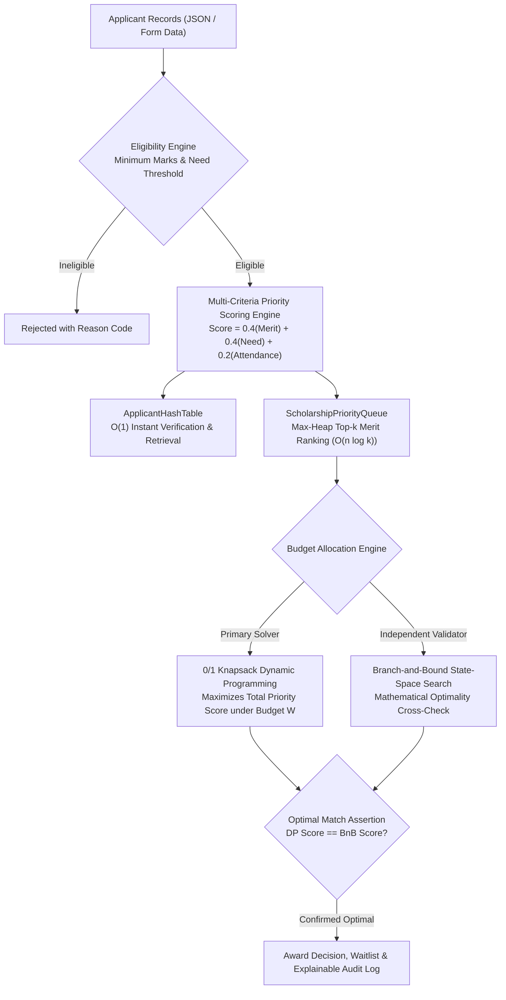

# Intelligent Scholarship Allocation System

[](https://www.python.org/)
[](https://flask.palletsprojects.com/)
[]()
[]()
[]()
[](https://sdgs.un.org/goals/goal4)

An explainable decision-support platform developed for the **Data Structures and Algorithms-II (CCSE0301)** Project-Based Learning (PBL) curriculum. It provides transparent eligibility evaluation, multi-criteria priority scoring, hash-indexed retrieval, heap-based ranking, and globally optimal institutional scholarship allocation under strict financial budget constraints.

---

## 🏛️ Algorithmic Decision Pipeline



---

## ⚡ Algorithmic Breakdown & Complexity

| Stage | Algorithm / Structure | Time Complexity | Space Complexity | Role in System |
| :--- | :--- | :---: | :---: | :--- |
| **Lookup** | `ApplicantHashTable` | $\mathcal{O}(1)$ avg | $\mathcal{O}(n)$ | Hash indexing with separate chaining for instantaneous applicant lookup |
| **Ranking** | `ScholarshipPriorityQueue` | $\mathcal{O}(n \log k)$ | $\mathcal{O}(k)$ | Binary Max-Heap extracting the top-$k$ prioritized candidates |
| **Allocation** | `0/1 Knapsack (DP)` | $\mathcal{O}(n \cdot W)$ | $\mathcal{O}(n \cdot W)$ | Solves the budget-constrained combinatorial allocation problem |
| **Validation** | `Branch & Bound` | $\mathcal{O}(2^n)$ worst / $\mathcal{O}(b^d)$ avg | $\mathcal{O}(n)$ | Prunes sub-optimal branches to rigorously cross-check DP optimality |

---

## 📊 Priority Scoring Formula

Each applicant receives an explainable composite merit score $\in [0, 100]$:

$$\text{Priority Score} = (0.40 \times \text{Academic Merit}) + (0.40 \times \text{Financial Need}) + (0.20 \times \text{Attendance})$$

* **Academic Merit**: Normalized GPA / percentage scale.
* **Financial Need**: Inverted household income bracket mapping (higher need yields higher weight).
* **Attendance**: Verified classroom participation metrics.

---

## 🧪 Automated Test Suite (41 Tests)

All modules, APIs, edge cases, and algorithmic optimality assertions are verified through Pytest:

```bash
cd backend
python -m pytest tests -o pythonpath=.
```

```text
============================= test session starts =============================
platform win32 -- Python 3.14.7, pytest-9.1.1
collected 41 items

tests/test_allocation.py .............                                   [ 31%]
tests/test_allocation_api.py ..                                          [ 36%]
tests/test_core.py ..............                                        [ 70%]
tests/test_hash_lookup_api.py ...                                        [ 78%]
tests/test_ranking.py .........                                          [100%]

============================= 41 passed in 1.12s ==============================
```

---

## 🚀 Running the Platform

### Prerequisites
* **Python**: 3.10+ and `pip`

```bash
# Clone the repository
git clone https://github.com/shutkarshX/Scholarship-Allocation-System.git
cd Scholarship-Allocation-System

# Install requirements
pip install -r requirements.txt

# Start the Flask dashboard & API server
python backend/app.py
```
*Open [http://127.0.0.1:5000](http://127.0.0.1:5000) to access the interactive allocation dashboard, inspect applicant merit ranks, configure institutional budget thresholds, and run optimization runs.*

---

## 📂 Repository Structure

```text
Scholarship-Allocation-System/
├── backend/
│   ├── app.py                      # Flask REST application & dashboard router
│   ├── algorithms/                 # Core DSA-II algorithmic implementations
│   │   ├── allocation.py           # Knapsack DP & Branch-and-Bound solvers
│   │   ├── hashing.py              # Custom hash table implementation
│   │   └── ranking.py              # Max-heap priority queue
│   ├── tests/                      # 41 automated Pytest unit tests
│   │   ├── test_allocation.py
│   │   ├── test_allocation_api.py
│   │   ├── test_core.py
│   │   ├── test_hash_lookup_api.py
│   │   └── test_ranking.py
├── frontend/                       # Interactive HTML/CSS dashboard templates
├── data/                           # Verified sample applicant records
├── docs/                           # Checkpoints, review notes & formal specs
├── requirements.txt
└── README.md
```

---

## 📜 Curriculum Alignment
* **Course:** Data Structures and Algorithms-II (`CCSE0301`).
* **UN Sustainable Development Goal:** SDG 4 — Quality Education (Transparent, merit-and-need equitable student aid distribution).
